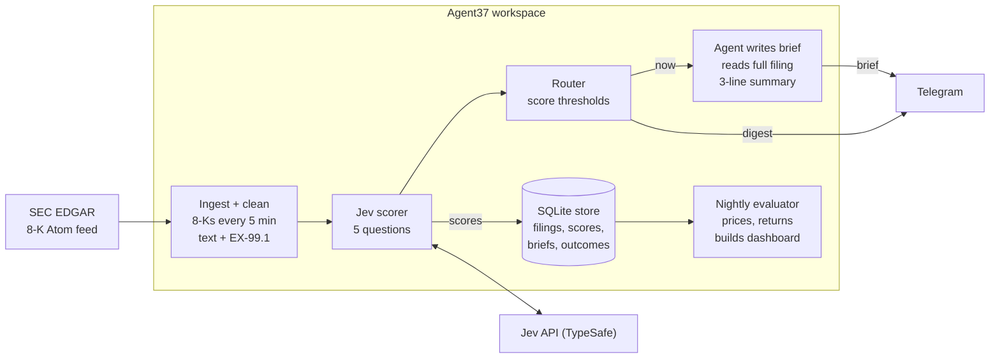

# Tape: Architecture

Tape reads every new SEC 8-K filing, uses Jev to score how material each one is, and has an always-on Agent37 agent brief you on Telegram about only the few that matter.

## Overview

**Problem.** Companies file hundreds of 8-Ks a day. Most are routine (a bylaw tweak, a shareholder vote tally). A few move the stock: a CEO exit, a guidance cut, a large acquisition. Finding those means skimming everything.

**Split of work.**

- **Jev judges.** Fast, cheap yes/no, choice and score questions on every filing. It never writes text.
- **Agent37 acts.** It runs the schedule, reads the full text of the top filings, writes the briefs, and messages you.

**Success metric.** Filings Jev scores as highly material should move their stock more the next trading day than filings it scores as routine. The target is a clear, measurable gap: the top 10% by score showing at least 2x the average absolute next-day abnormal return of the bottom 50%.

## System diagram



Every filing passes through ingest, Jev scoring and the router in a few seconds. Only filings routed `now` wake the agent, and `log` filings stop at the store.

## Components

Everything runs inside one Agent37 workspace. Plain Python does the repeatable work (fetch, score, store), and the agent is only asked to do judgment-heavy writing on the top filings. That keeps model credits low and the pipeline testable.

| Component | Module | Job | Runs as |
| --- | --- | --- | --- |
| Ingester | `tape/edgar.py` | Polls EDGAR's latest-filings Atom feed for 8-Ks, then pulls each filing's main document and press release exhibit (EX-99.1) | Agent37 scheduled job, every 5 minutes in market hours |
| Cleaner | `tape/clean.py` | Strips HTML, keeps the item headings and the first part of EX-99.1, trims to Jev's input budget | Same job, after ingest |
| Scorer | `tape/score.py` | Sends each cleaned filing to Jev with the question set below; stores every answer and its cost | Same job, after clean |
| Router | `tape/route.py` | Applies thresholds: brief now, add to the evening digest, or log only | Same job, after score |
| Briefer | `skills/tape-brief.md` | Reads the full filing for routed items and writes a three-line brief | The Agent37 agent itself |
| Notifier | `tape/notify.py` | Sends briefs and the digest to Telegram | Agent37's Telegram integration, or the Bot API fallback |
| Store | `tape/db.py` | Filings, scores, briefs, price outcomes and a log of each pipeline pass | A SQLite file in the workspace |
| Evaluator | `tape/evaluate.py` | Pulls prices, computes next-day abnormal returns, compares score groups and baselines | Nightly scheduled job, plus a one-time backfill |
| Dashboard | `tape/dashboard.py` | One page: today's scored filings, mean move by score, cost per day | Static HTML rebuilt nightly |

**EDGAR rules to respect.** No API key is needed. The SEC caps automated access at 10 requests per second and blocks IPs that exceed it, so the ingester throttles to 5 per second and sends a descriptive User-Agent with a contact email ([SEC developer resources](https://www.sec.gov/about/developer-resources)).

## Jev question design

Each filing gets one Jev request with five questions answered in parallel. The `state` is a JSON object with the company name, the 8-K item numbers and the cleaned filing text.

| Key | Type | Question | Used for |
| --- | --- | --- | --- |
| `materiality` | score (5 levels) | How likely is this filing to change how investors value the company? Routine to market-moving | The main ranking |
| `event` | choice | What kind of event is this? Leadership change, earnings or guidance, M&A, financing or debt, legal or regulatory, restructuring or layoffs, routine governance, other | Labels, filters, eval by event type |
| `direction` | choice | Is the news good, bad or mixed for shareholders? | Brief tone, a second backtest |
| `surprise` | noul | Does this filing reveal something investors likely did not expect? | Separates a scheduled earnings release from a sudden CEO exit |
| `boilerplate` | noul | Is this mostly procedural or legal boilerplate? | Fast discard of noise |

Jev's score primitive returns an expected score from 0 to 4 for a five-level rubric. Tape stores it shifted to a 1 to 5 scale so it reads naturally.

**Routing rule (starting thresholds, tuned during evaluation).**

- **Brief now:** materiality of 4 or more, or materiality 3+ with `surprise` above 0.7.
- **Evening digest:** materiality of 2.75 or more.
- **Log only:** everything else, including any filing with `boilerplate` above 0.8.

Any cutoff can be overridden for one event label (for example a stricter brief-now bar for
`earnings_guidance`, which is scheduled and frequent) with `TAPE_<THRESHOLD>__<EVENT>`.

Jev answers in roughly 70 to 500 ms and input costs $0.042 per million tokens, with output free ([Builder.io](https://www.builder.io/blog/what-is-jev)). At roughly 300 filings a day and about 2,000 tokens each, scoring costs a few cents a day.

## Data model

Four SQLite tables, all keyed on the EDGAR accession number so every stage can be rerun without duplicates.

| Table | Key columns | Notes |
| --- | --- | --- |
| `filings` | accession_no (PK), cik, ticker, company, form, items, accepted_at (ET), url, clean_text | `accepted_at` decides the event day: after the 4:00 pm ET close counts toward the next trading day |
| `scores` | accession_no, model, materiality, event, direction, surprise, boilerplate, raw_json, input_tokens, cost_usd, latency_ms, scored_at, materiality/event/direction_confidence, materiality_probs | Keeps the full Jev response so thresholds can be re-tuned without re-scoring; confidence columns flag uncertain scores for review |
| `briefs` | accession_no, route (now / digest / log), brief_text, sent_at | Only routed filings get a brief |
| `outcomes` | accession_no, event_day, stock_return, market_return, abnormal_return, abs_abnormal_return | Filled by the evaluator once the next day's prices exist |

Filings without a listed ticker (private debt issuers, funds) are stored but skipped in the evaluation.

## Evaluation

The test: do higher Jev materiality scores line up with bigger next-day stock moves, and does Jev beat a dumb rule?

**Method.**

1. **Backfill.** Pull the last 3 months of 8-Ks for listed companies and score them all.
2. **Event day.** The trading day the market first saw the filing (`accepted_at` before 4:00 pm ET on a trading day = same day, otherwise the next trading day).
3. **Move.** Abnormal return = stock return minus S&P 500 return (SPY) on the event day. Use the absolute value, since a big drop matters as much as a big jump.
4. **Compare groups.** Average absolute abnormal return by materiality score, 1 through 5.

**Baselines Jev has to beat.**

- **Random:** shuffled scores. Shows what no skill looks like.
- **Item-code rule:** flag any 8-K with items 1.01 (major agreement), 2.01 (acquisition), 2.02 (earnings) or 5.02 (executive change). This is what a programmer would write without any AI, so beating it is the real proof.

**Metrics.**

| Metric | What it answers |
| --- | --- |
| Mean absolute abnormal return, top 10% vs bottom 50% | The headline gap |
| Rank correlation (Spearman) between score and move | Does the whole ranking work, not just the top |
| Hit rate: share of top-10 daily picks that moved over 3% | Would the Telegram pings have been worth reading |
| Cost per filing and latency | Proof it is cheap enough to run on everything |

**Known weak spots.** Earnings releases are scheduled, so their moves are partly expected; the `surprise` question and a by-event-type breakdown address this. Jev may have seen some backfill-period news in training, so the live forward period (filings scored before prices exist) is the cleaner test and is reported separately.

## Stack and layout

Python 3.12+, `typesafe_sdk` for Jev, httpx and feedparser for EDGAR, SQLite, pandas for the evaluation.

```
tape/
  config.py      # settings from environment
  db.py          # SQLite schema and helpers
  edgar.py       # EDGAR feed, filing documents, ticker map (throttled)
  clean.py       # HTML to text, trim to budget
  score.py       # Jev questions and call
  route.py       # thresholds -> now / digest / log
  pipeline.py    # one ingest -> score -> route pass
  evaluate.py    # prices, abnormal returns, metrics, baselines
  dashboard.py   # static HTML page
  notify.py      # Telegram digest fallback
  cli.py         # `tape` command
skills/
  tape-brief.md  # instructions the Agent37 agent follows to write a brief
deploy/
  agent37.md     # workspace setup and schedules
tests/
```

**Running cost.** Agent37 Basic at $3.99/month covers Telegram ([pricing](https://agent37.com/personal)). Jev scoring is cents per day. Agent credits are only spent on the handful of filings that get a brief.

## Build order

1. Ingest and store one day of 8-Ks.
2. Score them with Jev and eyeball the top and bottom 20.
3. Backfill 3 months, pull prices, run the evaluation against both baselines.
4. Tune thresholds from the results.
5. Deploy to Agent37: schedule, brief skill, Telegram.
6. Run live for 2 to 4 weeks and report the forward-period results on the dashboard.

## Open questions

- Can Agent37 scheduled jobs run Python directly, and how does a script wake the agent? Its developer API is not documented publicly in detail.
- Jev's maximum input size per request (sets how much of each filing we send).
- Price data source: yfinance is free but unofficial; a free-tier API is the fallback.
